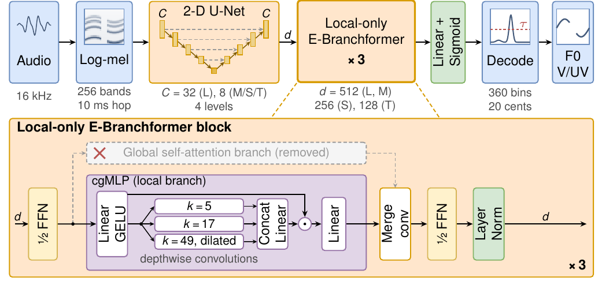

# CUBE: Efficient and Noise-Robust F0 Estimation

Inference code and pretrained models for

> **CUBE: Efficient and Noise-Robust F0 Estimator for Speech, Singing Voice, and Instrumental Music**<br>
> Eray Eren, Zilai Wang, Natarajan Balaji Shankar, Kaiyuan Zhang, Mohan Shi, Abeer Alwan<br>
> University of California, Los Angeles. Submitted to ICASSP 2027.

CUBE (**C**onsensus **U**-Net **B**ranchformer **E**stimator) estimates the fundamental frequency (F0)
of speech, singing voice and monophonic instrumental music every 10 ms, together with a voiced/unvoiced
decision. Its accuracy holds up across noise types: white, pink, babble, ambient and music noise, and
reverberation. It comes in four sizes. The largest, CUBE-L, is the most accurate. The smallest,
CUBE-T, has 1.84 M parameters and runs about 50 times faster than real time on a single CPU thread.

<p align="center"></p>

## Highlights

- **Robust in noise.** On three out-of-domain test corpora (Keele speech, Vocadito singing voice and
  Bach10 instrumental music), averaged over clean audio and seven noise and reverberation conditions,
  CUBE-L improves raw pitch accuracy by 3.3 points and voicing F1 by 1.8 points over RMVPE.
- **Small and fast.** CUBE-T uses 98% fewer parameters and 84% less computation than RMVPE and is more
  accurate than both RMVPE and FCPE in noise. On one CPU thread it is the fastest of the six models in
  the table below.
- **Consensus labels for resynthesis.** Training is augmented with speech and singing voice resynthesized
  from F0 contours on which several DSP pitch trackers agree. No neural F0 estimator is used to make the
  training labels.
- **Distilled students.** CUBE-M, CUBE-S and CUBE-T are trained by knowledge distillation from CUBE-L.

## How it works

1. The 16 kHz waveform is converted to a 256-band log-mel spectrogram with a 10 ms hop.
2. A 2-D U-Net with four levels processes the spectrogram, and a final convolution projects every frame
   to a `d`-dimensional vector.
3. Three local-only E-Branchformer blocks model time. They are E-Branchformer blocks with the global
   self-attention branch removed. What remains is the cgMLP branch, whose gate uses three parallel
   depthwise convolutions with kernels of 5, 17 and 49 frames (only the widest is dilated).
4. A linear layer with a sigmoid gives a salience for each of 360 pitch bins, spaced 20 cents apart
   from 31.7 Hz to 2005.5 Hz.
5. A frame is voiced when its peak salience exceeds the threshold τ (default 0.12). F0 is the
   salience-weighted average of the peak bin and the four bins on either side.

## Models and results

| Model | Params (M) | GMACs | RPA clean | RPA noisy | F1 clean | F1 noisy | RTF, CPU 1 thread | RTF, GPU |
|---|---:|---:|---:|---:|---:|---:|---:|---:|
| **CUBE-L** | 27.80 | 19.31 | 94.88 | **84.39** | **94.52** | 87.23 | 0.203 | 0.0022 |
| **CUBE-M** | 22.19 | 5.31 | 94.69 | 83.94 | 94.36 | **87.24** | 0.055 | 0.0014 |
| **CUBE-S** | 6.06 | 2.09 | 94.67 | 83.69 | 94.37 | 86.95 | 0.027 | 0.0012 |
| **CUBE-T** | 1.84 | 1.25 | 94.65 | 83.03 | 94.39 | 86.83 | **0.019** | 0.0012 |
| RMVPE | 90.40 | 7.67 | 94.30 | 80.58 | 93.89 | 84.50 | 0.080 | 0.0024 |
| FCPE | 10.83 | 2.14 | **95.00** | 78.21 | 93.18 | 81.93 | 0.025 | **0.0003** |

- **Accuracy:** raw pitch accuracy (RPA, the share of voiced frames within 50 cents) and voicing F1, in
  percent. Both are averaged over six test corpora: PTDB-TUG, Keele, MIR-1K, Vocadito, MDB-stem-synth
  and Bach10.
- **Noisy:** the average over seven conditions. Six are additive noise (white, pink, babble, WHAM!,
  CHiME and music) at 20, 10, 0 and −10 dB SNR. The seventh is reverberation from measured impulse
  responses at direct-to-reverberant ratios of 10, 5, 0 and −5 dB.
- **Cost:** GMACs are counted for 2 s of audio. RTF (real-time factor) is processing time divided by
  audio duration, measured for a 10 s clip with batch size 1 in fp32, from waveform to F0 including
  decoding. Lower is better. CPU: one thread of an AMD Ryzen Threadripper PRO 5955WX. GPU: NVIDIA RTX
  A6000.
- **Baselines:** RMVPE and FCPE are evaluated with their released models and default settings.

To choose a model: CUBE-L is the most accurate. CUBE-M is almost as accurate with about a quarter of
the computation. CUBE-T is the one for CPU and real-time use.

## Installation

```bash
git clone https://github.com/errayeren/robustf0estimation.git
cd robustf0estimation
pip install .
```

This needs Python 3.9 or newer, PyTorch 2.1 or newer, torchaudio, NumPy, soundfile and soxr.

### Pretrained weights

The weights are published as assets on this repository's
[Releases](https://github.com/errayeren/robustf0estimation/releases) page. Each model is a weights file
and a small config file:

| Model | Files | Size |
|---|---|---:|
| CUBE-L | `cube-l.pt`, `cube-l.json` | 112 MB |
| CUBE-M | `cube-m.pt`, `cube-m.json` | 89 MB |
| CUBE-S | `cube-s.pt`, `cube-s.json` | 25 MB |
| CUBE-T | `cube-t.pt`, `cube-t.json` | 8 MB |

Put the files in `weights/` in the repository, or in `~/.cache/cube/`, or in a directory named by the
`CUBE_WEIGHTS_DIR` environment variable. To check the downloads, run `sha256sum -c SHA256SUMS` in
that directory.

## Usage

### Python

```python
import cube

model = cube.CUBE.from_pretrained("cube-t")    # "cube-l", "cube-m", "cube-s" or "cube-t"
y, sr = cube.load_audio("example.wav")
out = model.predict(y, sr)

out["time_s"]       # frame times in seconds: 0.00, 0.01, 0.02, ...
out["f0_hz"]        # F0 in Hz, 0 on unvoiced frames
out["confidence"]   # peak salience in [0, 1]
out["voiced"]       # True where confidence > tau
```

- **Input:** `predict` takes a NumPy array or a torch tensor at any sample rate, either mono or shaped
  `(channels, samples)`. Audio is mixed down to mono and resampled to 16 kHz.
- **Voicing threshold:** `tau` defaults to 0.12, the value selected on development data. Raise it for
  fewer false voiced frames, or lower it to catch more weak voicing.
- **Device:** the model runs on the GPU when one is available. Pass `device="cpu"` (or `"cuda"`) to
  `from_pretrained` to choose.
- **Logits:** `model.logits(y, sr)` returns the raw `(frames, 360)` pitch logits.
- **Long recordings:** recordings longer than one minute are processed in 30 s windows with overlapping
  context. The result is the same as a single pass.

### Command line

```bash
cube-f0 input.wav --model cube-t --out f0.csv
```

The CSV has one row per 10 ms frame, with the columns `time_s,f0_hz,confidence,voiced`. The command
reads any format that libsndfile supports (WAV, FLAC, OGG, MP3 and others). Without `--out`, the CSV is
written to standard output.

- `--tau` sets the voicing threshold.
- `--device` chooses `cpu` or `cuda`.
- `--threads` sets the number of CPU threads.

`python -m cube` works the same as `cube-f0`.

## Tests

```bash
pip install ".[test]"
pytest
```

The tests check that your installation reproduces the outputs of the implementation used for the paper
on a short synthetic signal stored in `tests/data/`. Tests that need a model are skipped if its weights
are not found.

## Training code

This release contains inference code and pretrained models only. The training code and the consensus
labelling pipeline will be released when the paper is accepted.

## License

- **Code:** [MIT License](LICENSE).
- **Model weights:** [Creative Commons Attribution-NonCommercial-ShareAlike 4.0 International](MODEL_LICENSE).

The code may be used for any purpose under the MIT License. The pretrained weights may be used for
research, teaching, personal projects and other non-commercial purposes only. They may not be used, nor
anything derived from them, for commercial purposes, including in a commercial product or service.

The weights are also ShareAlike. If you share a model adapted from them, it must carry the same license,
and you must credit this work. This summary is for orientation only; `LICENSE` and `MODEL_LICENSE` are
the binding terms.

The weights are non-commercial because some training data are licensed for non-commercial use only,
including M4Singer (CC BY-NC-SA 4.0) and WHAM! noise (CC BY-NC 4.0).

**A commercially licensed model, trained only on commercially usable data, is in preparation.**
